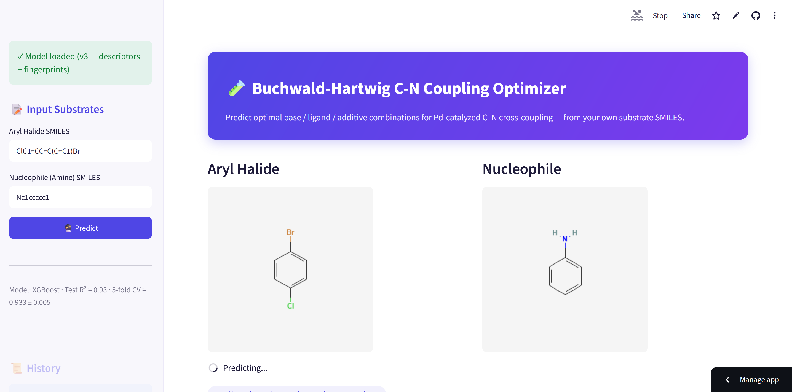
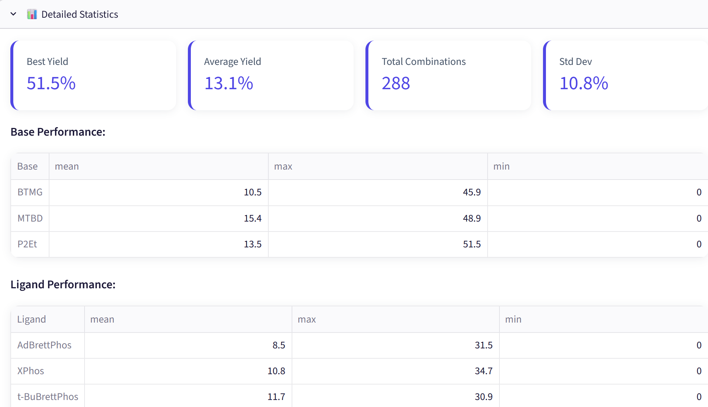

# 🧪 Buchwald-Hartwig C-N Coupling Optimizer

A gradient-boosting model and Streamlit app that predicts the yield of Buchwald-Hartwig C-N couplings for a user-supplied aryl halide and amine, across 288 combinations of base, ligand and additive.

<a href="https://github.com/slastrzelec/buchwald-hartwig-optimizer" target="_blank" rel="noopener noreferrer">GitHub Repository</a> · <a href="https://buchwald-hartwig-optimizer.streamlit.app/" target="_blank" rel="noopener noreferrer">Live demo (Streamlit)</a>

## Why this project

Choosing a base, a ligand and an additive for a cross-coupling is mostly trial and error, and one high-throughput screen can cover only so many combinations. The goal is to shortlist promising conditions for a given pair of substrates before they are run at the bench. The project also shows how a plausible-looking model can be completely wrong: its first version reached R² 0.30 because of a silent bug, and the story of finding it is part of the result.

## Results at a glance

XGBoost regressor on 4,312 reactions; features are 19 physicochemical descriptors and a 128-bit Morgan fingerprint for the aryl halide and for the coupling product, combined with the one-hot identity of 3 bases, 4 ligands and 24 additives (327 features).

| Version | Approach | Test R² |
|---|---|---|
| v1 | Descriptors only (the descriptor code silently failed) | 0.30 |
| v2 | Same descriptors, bug fixed | 0.72 |
| v3 | Added 128-bit Morgan fingerprints | 0.93 (5-fold CV 0.933 ± 0.005) |

## What the evaluation showed

- **The 0.30 was a bug, not a limit of the data.** Two RDKit calls were wrong (`Descriptors.FractionCsp3` has a different capitalisation and `Descriptors.NumAromaticAtoms` does not exist). Both raised `AttributeError`, which a broad `except Exception: return None` swallowed. Every descriptor of every reaction came back empty and was dropped, so the model learned from the identity of the base, ligand and additive alone.
- **The deployed app had a second, separate bug.** It validated the user's SMILES and then ignored them, so every input got the same answer, and it offered an additive list that was not the one the model was trained on. Fixing the pipeline and the app took R² from 0.30 to 0.72.
- **Fingerprints added the structural information that bulk descriptors lack.** Molecular weight, LogP and TPSA summarise a molecule but do not encode its substructure. With the fingerprints R² rose to 0.93, and the feature importance ranks individual fingerprint bits above every descriptor.
- **Five-fold cross-validation agrees with the single split** (0.933 ± 0.005), so 0.93 is not a lucky split. See the limitations for what that number does and does not say.

## Methodology

- **Input and product:** SMILES are validated with RDKit, and the coupling product is generated from an RDKit reaction template. The more reactive C–I or C–Br bond is preferred over C–Cl.
- **Prediction:** for the given substrates the model scores all 288 base × ligand × additive combinations and returns the top 10.
- **Data:** a high-throughput experimentation (HTE) dataset of Buchwald-Hartwig yields; 287 incomplete rows were removed.
- **Model choice:** Random Forest, Gradient Boosting and XGBoost were compared at each stage; XGBoost was kept.
- **Export:** results can be downloaded as CSV or as a PDF report with structures.

## Testing

**22 automated tests run on every push and pull request** (pytest in GitHub Actions).

**What is verified**

- **Chemistry and features:** input validation, descriptor calculation and fingerprints on known molecules.
- **Reaction generation:** the coupling product is produced for typical substrates.
- **Regression test for the second bug:** two different substrates must give different predicted yields, so an app that ignores its input fails the suite.

**Not covered**

- The model's accuracy: tests check that the pipeline works, not that R² stays at 0.93.
- Predictions for substrates outside the training data.
- The Streamlit interface and the PDF export: there are no automated tests for them.

## Limitations

- **The R² of 0.93 comes from a random split of the reactions.** Reactions that share a substrate end up in both the training and the test set, so the score says how well the model fills gaps in a known screen. It does not show how it behaves for a new aryl halide or amine. A split that holds out substrates has not been run.
- **A high-throughput screen covers a limited set of substrates.** For structures far from them the predictions are extrapolation.
- **The product is made by one simplified reaction template** (the most reactive halide and the first available N–H). It may not resolve a product for unusual structures.
- Predicted yields are a shortlist to test, not a replacement for the experiment.

**Tech stack:** Python, XGBoost, scikit-learn, RDKit, Streamlit, ReportLab, pytest, GitHub Actions.

**Related:** the [Drug Solubility Predictor](../drug-solubility-prediction/index.md) and the [logP Predictor](../molecular-lipophilicity-ai/index.md) use the same cheminformatics toolkit for single-molecule properties instead of reaction yield.
