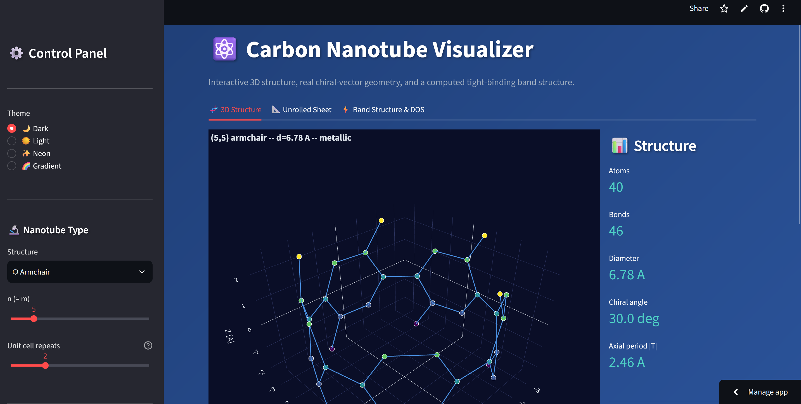
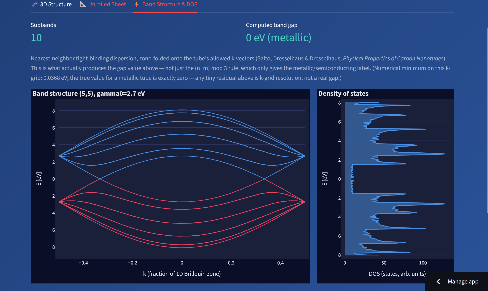

# ⚛️ Carbon Nanotube Visualizer

An interactive Streamlit tool that builds a single-walled carbon nanotube from its chiral indices (n, m), shows it in 3D and computes its electronic band structure with a tight-binding model.

<a href="https://github.com/slastrzelec/carbon-nanotube-visualizer" target="_blank" rel="noopener noreferrer">GitHub Repository</a> · <a href="https://github.com/slastrzelec/carbon-nanotube-visualizer/blob/main/SPEC.md" target="_blank" rel="noopener noreferrer">Specification</a> · <a href="https://carbon-nanotube-visualizer.streamlit.app/" target="_blank" rel="noopener noreferrer">Live demo (Streamlit)</a>

## Why this project

A nanotube is fixed by two integers (n, m): they set the diameter, the chiral angle and whether the tube conducts. The textbook rule (n − m) mod 3 = 0 gives the label but shows nothing behind it. This tool builds the atomic structure, draws the graphene sheet that is rolled into it, and computes the bands from which the label follows. It is a rebuild: the earlier version drew the Armchair, Zigzag and Chiral presets with a ring-stacking heuristic that did not implement the physics the interface described, and only the "custom (n, m)" mode was correct.

## Results at a glance

There is no benchmark score here. The result is a structure and a calculation whose output can be checked against known physics:

| Output | How it is obtained |
|---|---|
| Atomic coordinates | ASE nanotube builder, one engine for all four modes |
| Bonds | Nearest-neighbour detection by distance with a KD-tree |
| Diameter, axial period | Reported with the structure and cross-checked against closed-form formulas |
| Bands and density of states | Nearest-neighbour tight-binding, zone-folded onto the tube's allowed k-vectors |
| Export | XYZ and PDB (with CONECT records); PNG, SVG, PDF when a Chrome binary is available |

$$D = \frac{a \cdot |\vec{C}|}{\pi} = \frac{\sqrt{3} \cdot a_{cc} \cdot \sqrt{n^2 + nm + m^2}}{\pi}$$

The (5,5) armchair tube shows a zero gap (metallic), as the theory requires. The small minimum visible on the finite k-grid is labelled in the app as a resolution artefact and not as a gap.

## What the evaluation showed

- **A naive formula failed against the test.** The computed gap was compared with the (n − m) mod 3 rule for 10 different (n, m) pairs. A "compact" gap formula that looked right gave the wrong answer for armchair tubes, which is why the app takes the metallic or semiconducting label from the exact integer rule and shows the numerical minimum separately.
- **The geometry was cross-checked two ways:** against the ASE builder and against closed-form formulas for diameter and translation period, so a change in the geometry cannot go unnoticed.

## Methodology

- **Geometry:** ASE's nanotube builder for armchair, zigzag, chiral and custom tubes, with metadata (diameter, chiral angle, axial period).
- **Bands:** a nearest-neighbour tight-binding Hamiltonian built from graphene's three bond vectors; the dispersion is zone-folded onto the k-vectors allowed by the tube's circumference, obtained numerically from the chiral and translation vectors. The hopping integral γ₀ is adjustable.
- **Visualisation:** Plotly 3D with four render styles, an unrolled graphene sheet showing the chiral vector **C** and the translation vector **T**, and interactive band and density-of-states plots.
- **Graceful degradation:** when no Chrome binary is available, image export is disabled and XYZ/PDB export still works.
- Physics references and the rationale are in `SPEC.md` (Saito, Dresselhaus and Dresselhaus; Iijima).

## Testing

**Automated tests run on every push and pull request** (pytest in GitHub Actions) and compare the code with physical ground truth, not only with "it runs".

**What is verified**

- **Geometry:** every detected bond must be within 2% of the real C–C distance of 1.42 Å, and atom counts, diameter and period must agree with the closed-form formulas.
- **Band structure:** the computed gap must agree with the exact (n − m) mod 3 metallic rule.
- **Interface:** headless UI tests with Streamlit's `AppTest`, including the case where image export is unavailable.

**Not covered**

- Agreement with first-principles (DFT) results or with measured gaps: the model is compared with theory, not with experiment.
- The visual quality of the 3D rendering in the browser.

## Limitations

- **Nearest-neighbour tight-binding is the simplest model.** It ignores curvature effects, which open small gaps in some tubes that the model calls metallic, and it ignores excitons, so the computed gaps are not the optical gaps of real samples.
- **The tubes are open and uncapped.** A few atoms at the two cut edges have one neighbour; this is physically normal for an open end. Capped or hydrogen-terminated ends are not implemented.
- A visualisation and teaching tool, not a simulation of real samples.

**Tech stack:** Python, ASE, NumPy, SciPy, Plotly, Streamlit, pytest, GitHub Actions.

**Related:** the same carbon-nanotube topic from the experimental side is the [Raman Spectroscopy Analyzer](../raman-spectroscopy-analyzer/index.md), and the research literature is covered by the [Carbon Nanotubes RAG System](../carbon-nanotubes-rag/index.md).
