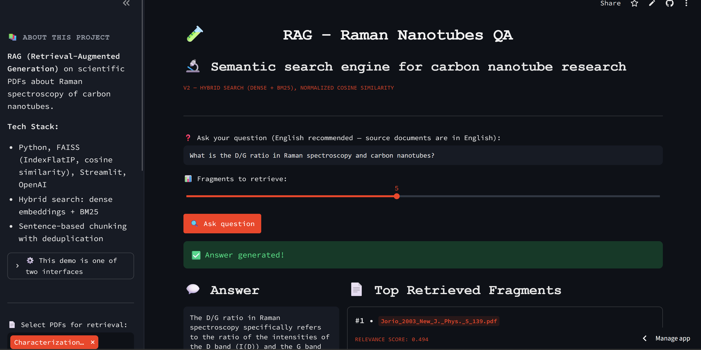

# 💡 Carbon Nanotubes RAG System

A retrieval-augmented question-answering system over 24 scientific papers on Raman spectroscopy of carbon nanotubes, with hybrid search, a FastAPI service, Docker, CI and a measured answer-quality score.

<a href="https://github.com/slastrzelec/carbon-nanotubes-rag" target="_blank" rel="noopener noreferrer">GitHub Repository</a> · <a href="https://carbon-nanotubes-raman-rag.streamlit.app" target="_blank" rel="noopener noreferrer">Live Streamlit demo</a> · <a href="https://rag-raman-api.onrender.com/docs" target="_blank" rel="noopener noreferrer">Live REST API (Swagger docs)</a>



## Why this project

A language model asked about a narrow technical field answers fluently and sometimes wrongly. For a domain question such as "what does the D/G ratio tell about defects?" the useful answer comes from the papers, with the source named. This project builds that path: the papers are indexed, the question is matched to the relevant passages, and the model answers only from them. It started as a Streamlit prototype that used Euclidean distance on unnormalised vectors and cut text at 500 characters, and was rebuilt in six documented phases into a tested, deployed service.

## Results at a glance

| Measure | Result |
|---|---|
| Answer faithfulness (RAGAs, LLM judge) | about 0.80–0.82 over 14 domain questions |
| Out-of-scope question ("melting point of carbon nanotubes") | 1.0: the system said the context did not contain the answer |
| Automated tests | 31, on every push |
| Public API | `/query`, `/documents`, `/health`; request validation, readable errors, Swagger docs |

Faithfulness asks whether the answer stays within the retrieved context. In most of the lower-scoring answers retrieval was correct, but the model added accurate textbook facts that the retrieved passages did not contain; that is a property of the current prompt, not hallucination, and it is recorded rather than hidden.

## What the evaluation showed

- **The duplicate check found a real data problem.** The same paper was saved under two filenames and filled the top of every search with identical results. Content hashing removed it.
- **Hybrid search covers what embeddings miss.** Exact terms and abbreviations such as RBM or SWNT are matched by BM25 next to the dense retrieval.
- **A 512 MB free-tier container only fits with CPU-only PyTorch.** The default build pulls a CUDA version of 800 MB to 2 GB.

## Methodology

```
PDF corpus
    ↓
Deduplication + sentence-based chunking (about 120 words, with overlap)
    ↓
Embeddings (all-MiniLM-L6-v2, L2-normalised) → FAISS IndexFlatIP
    ↓
Question → hybrid retrieval (dense + BM25)
    ↓
Generation from the retrieved context only (gpt-4o-mini)
    ↓
Answer + cited sources
```

- **Cosine similarity done correctly:** `IndexFlatIP` over normalised vectors instead of Euclidean distance on raw ones.
- **One implementation, two interfaces:** the Streamlit UI and the FastAPI service are thin layers over the same modules for ingestion, retrieval and generation.
- **Operations:** structured JSON logs (method, path, status, duration, and for queries the number of sources and generation time), separate Docker images for API and UI with docker-compose, CI on every push, deployment on Render from the same Dockerfile.
- **Cost protection for the public demo:** questions are limited to 500 characters; the API allows 10 requests per minute per client and 500 queries per day in total; the UI has daily and per-session caps; the default example answer is cached.

## Testing

**31 automated tests run on every push and pull request** (pytest in GitHub Actions). They need no OpenAI key and no built index.

**What is verified**

- **Ingestion:** chunking and content-hash deduplication.
- **API:** all three endpoints, request validation (empty or whitespace questions, `top_k` out of range, missing fields) and the 502 response when the pipeline fails.
- **Logging middleware:** request details are captured for successful and for rejected requests.

**Not covered**

- **Answer quality in CI.** The OpenAI calls are mocked in the tests. Quality is measured separately with RAGAs, which makes real API calls and is not part of the suite.
- **Retrieval quality.** `context_precision` was not measured because it needs reference answers.
- The deployed service under load, and the rate limiter across restarts or several instances.

## Limitations

- The evaluation uses 14 hand-written questions and one metric scored by an LLM judge, so 0.80–0.82 is an indication, not a precise measurement.
- The corpus is 24 papers. A question outside it gets a refusal or a general-knowledge answer, not a literature search.
- The embedding model is small and general-purpose, not tuned for spectroscopy terms.
- The rate limits live in process memory: they reset on restart and are not shared between instances. The per-client key comes from `X-Forwarded-For` and can be spoofed, so the daily cap is the real cost ceiling.
- The live API runs on a free tier and sleeps after 15 minutes without requests; the first request can take 30–60 seconds.

**Tech stack:** Python, FAISS, sentence-transformers, BM25, OpenAI API, FastAPI, Pydantic, Streamlit, Docker, docker-compose, RAGAs, pytest, GitHub Actions, Render.

**Related:** the same carbon-nanotube topic is covered by the [Raman Spectroscopy Analyzer](../raman-spectroscopy-analyzer/index.md) (experimental spectra) and the [Carbon Nanotube Visualizer](../carbon-nanotube-visualizer/index.md) (structure and electronic properties).
