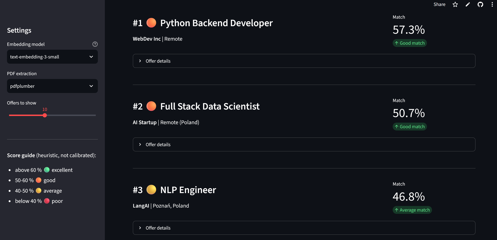

# 🎯 CV Job Matcher

A Streamlit app that ranks job offers against a CV with OpenAI embeddings, with a privacy-first data flow and a test suite that needs no API key.

<a href="https://github.com/slastrzelec/azure-cv-matching-openai-embeddings" target="_blank" rel="noopener noreferrer">GitHub Repository</a> · <a href="https://cv-matching-openai-embeddings.streamlit.app/" target="_blank" rel="noopener noreferrer">Live demo (Streamlit; the app sleeps when idle and wakes up with one click)</a>


*Ranking of the bundled fictional sample offers for one CV. Scores are cosine similarities of OpenAI embeddings; the bands are heuristic.*

## Why this project

Reading dozens of job offers against your own CV is slow, and keyword search misses offers that describe the same skills in other words. The idea: condense the CV into a short list of skills, embed it together with the offers and rank by similarity. The project is **a demonstration of an embedding pipeline, not a validated recommender**: there is no labelled relevance data, so match quality has not been measured, and the 60/50/40% score bands are heuristic. What it shows is the engineering around the model: batching, caching, failure handling, privacy and tests. It was built bottom-up, with three exploratory notebooks, then the application, then a hardening release (privacy, correctness, tests, CI) driven by a written specification.

## Results at a glance

A CV against 5 **fictional** sample offers (exploratory notebook). This shows that the pipeline runs and ranks plausibly, not how good it is on real data:

| Rank | Job title | Match score |
|---|---|---|
| 1 | Senior Machine Learning Engineer | 61.37% |
| 2 | AI Research Engineer | 49.76% |
| 3 | Data Scientist | 49.53% |
| 4 | Python Backend Developer | 49.10% |
| 5 | Junior Python Developer | 44.70% |

`text-embedding-3` similarities are compressed (rarely above 0.7), so the percentages are relative.

## What the evaluation showed

- **A silent wrong ranking was found and removed.** The first version skipped an offer whose embedding request failed but kept it in the list, so `zip(jobs, similarities)` attached scores to the wrong offers. Embedding is now all-or-nothing: on failure the app shows an error and no ranking, and `rank_jobs` raises if the two lists differ in length.
- **Condensing the CV helped in a small comparison.** On 5 fictional offers the condensed version ranked the expected role first. This is an observation, not a proven effect.
- **An earlier version exposed other people's data.** It could store uploaded CVs in cloud storage and list recent file names to all visitors. The code was removed entirely.

## Methodology

```
[Upload PDF] → in-memory text extraction (pdfplumber / pypdf)
      ↓
[gpt-4o-mini] → skills summary (~400 characters)
      ↓
[text-embedding-3-small] → CV vector (1536-dim)
      ↓
[The Muse API / cached file / bundled sample offers]
      ↓
[batched embeddings, up to 100 texts per request, cached 1 h]
      ↓
[cosine similarity (NumPy)] → ranked offers + CSV export
```

- **Why condense the CV?** A full CV contains dates, formatting and project prose that dilute the vector.
- **Batching and caching:** one request per offer meant 100+ API calls per click; offers are now embedded in batches of up to 100 and cached for an hour per offer set.
- **First start without the network:** the app uses the cached file or the bundled fictional sample offers (and says so); the network is used only on *Refresh DB*.
- **External data is untrusted:** only `http(s)` links are rendered, and CSV cells that start with `=`, `+`, `-` or `@` are neutralised against spreadsheet formula injection.

## Data and privacy: what happens to your CV

| Step | What happens |
|---|---|
| Upload | PDF read in memory (max 5 MB, first 10 pages); never written to disk |
| Skills extraction | CV text (max 20,000 characters) is sent to OpenAI; the UI says so |
| Matching | only the short skills summary is embedded |
| Storage | nothing is stored; the app has no storage code and no cloud-storage dependency |

## Testing

**38 automated tests run on every push and pull request** (GitHub Actions, Python 3.11, plus `ruff`). They need no API key and no network: OpenAI is replaced by a deterministic fake client.

**What is verified**

- **Ranking:** ordering, length mismatch raises, input not mutated, rating thresholds.
- **Embeddings:** batching (calls = ceil(n/100)), row *i* belongs to text *i* even when the API returns items out of order, a failed request raises instead of returning partial results, long and empty texts.
- **PDF:** text extraction from generated PDFs with both libraries, garbage input, page limit.
- **Job data:** HTML stripping, payload formatting, de-duplication, network errors, `javascript:` links dropped, cache and sample fallback.
- **Privacy rules:** no "Recent CVs" in the UI, no storage option, and no storage module or cloud-storage dependency in code, requirements, workflows or settings.
- **App:** Streamlit `AppTest` runs the whole script, including matching end to end and "no ranking on embedding failure".
- **Repository hygiene:** no `.env`, PDF or generated files tracked; no e-mail address or phone number in tracked notebook outputs.

**How the tests were checked:** re-introducing the length-mismatch bug, swallowing a failed embedding batch, removing the CSV neutralisation, bringing back the CV list or adding cloud-storage code each make the suite fail.

**Not covered:** the real OpenAI and The Muse APIs, match quality (no ground truth), and uploading a file through the browser widget.

## Limitations

- Match quality is unmeasured, and the notebook comparison rests on 5 fictional offers.
- The Muse API returns mostly US-centric offers and only the first page (20) per search term.
- The CV text is processed by a third party (OpenAI); this is stated in the UI.

**Tech stack:** Python 3.11, Streamlit, OpenAI API (`gpt-4o-mini`, `text-embedding-3-small/large`), NumPy, pandas, pdfplumber, pypdf, The Muse API, pytest, ruff, GitHub Actions, Dependabot.

**Related:** the [Scientific Research Agent](../research-agent-langchain/index.md) is another OpenAI-based application tested with a scripted fake model; it also carries a measured evaluation, which this project lacks. The [Carbon Nanotubes RAG System](../carbon-nanotubes-rag/index.md) uses embeddings with a measured answer quality (RAGAs).
