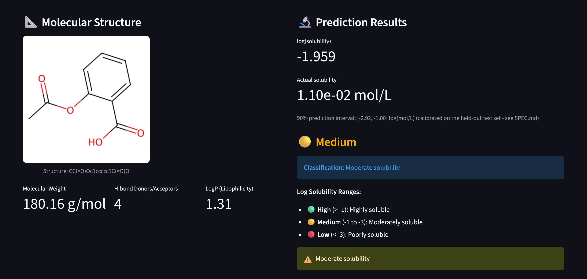
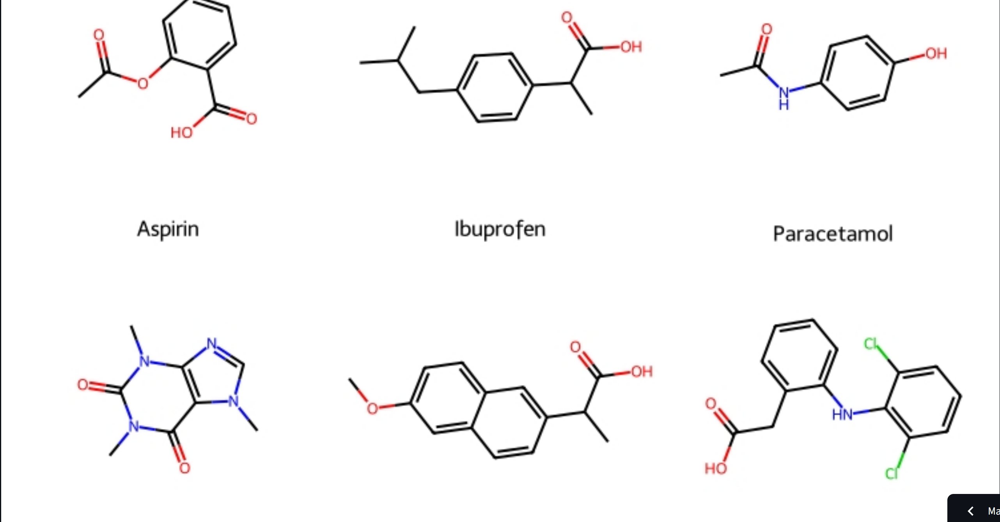

# 💊 Drug Solubility Predictor

An XGBoost pipeline that predicts the aqueous solubility of a drug molecule from its SMILES string, with a prediction interval, an applicability-domain check, a Streamlit app and a FastAPI service.

<a href="https://github.com/slastrzelec/drug-solubility-prediction" target="_blank" rel="noopener noreferrer">GitHub Repository</a> · <a href="https://github.com/slastrzelec/drug-solubility-prediction/blob/main/SPEC.md" target="_blank" rel="noopener noreferrer">Specification</a> · <a href="https://drug-solubility-prediction.streamlit.app/" target="_blank" rel="noopener noreferrer">Live demo (Streamlit)</a>

## Why this project

A compound that does not dissolve in water is hard to turn into a drug, so solubility is checked early. Measuring it for every candidate is slow, and a model that gives only a number is risky: a user cannot tell when the number is a guess. This project predicts log solubility and says how far to trust the answer. The first version, a fingerprint-only Random Forest, reached R² 0.70. I rebuilt it from a written specification with leakage rules, then tested it on a second dataset.

## Results at a glance

ESOL, 1,144 compounds, random 80/20 split (915 training and 229 test molecules). Features: a 2,048-bit Morgan fingerprint and 7 RDKit descriptors; 1,028 of the 2,055 features are kept by feature selection.

| | Test R² | RMSE | MAE |
|---|---|---|---|
| Fingerprint-only Random Forest (baseline) | 0.6985 | 1.146 | 0.860 |
| XGBoost with descriptors (current) | 0.9116 | 0.620 | 0.482 |
| AqSolDB, 8,881 compounds never seen in training | 0.638 | 1.443 | 0.988 |

RMSE and MAE are in log(mol/L). Four models were compared with 5-fold cross-validation on the training set only (SVR 0.732, Random Forest 0.852, Gradient Boosting 0.887, XGBoost 0.893), and the 229-row test set was scored once.

## What the evaluation showed

- **Descriptors, not a bigger model, made the difference.** MolLogP alone carries 17.5% of the feature importance, more than the next five fingerprint bits together, which agrees with the role of LogP in solubility theory. The train/test gap fell from 0.24 to 0.06, so the gain is generalisation and not only a better fit.
- **The external score is much lower, and it is reported next to the 0.91.** On AqSolDB R² drops to 0.64. The test score measures how well the model works close to ESOL, not how well it works on drugs in general.
- **Every prediction carries a warning signal.** A 90% interval of about ±0.96 log units, and a flag when the nearest training molecule has a Tanimoto similarity below 0.40. The flag was motivated by the external result.

## Methodology

- **Specification first.** `SPEC.md` fixes the feature set and the leakage rules before the code.
- **No leakage into the test set.** Scaling and feature selection are steps of one scikit-learn pipeline fitted on the training data only; nothing from the test set or from AqSolDB reaches them.
- **External data cleaned of overlap.** 1,099 AqSolDB compounds that also appear in ESOL (found by canonical SMILES) were removed before scoring.
- **Interval:** split conformal prediction, a 90th percentile of absolute residuals.
- **Two front ends, one implementation:** the Streamlit app and the FastAPI service (`POST /predict`, `GET /health`, Pydantic validation, Dockerfile) load the same trained pipeline and call the same prediction function.

## Testing

**Automated tests run on every push and pull request** (pytest in GitHub Actions).

**What is verified**

- **Features and prediction logic:** feature construction and the solubility classification.
- **A leakage guardrail** is part of the suite.
- **Uncertainty:** the prediction interval and the applicability-domain check.
- **API:** the FastAPI service.

**Not covered**

- The accuracy of the model: tests check the code, not that R² stays at 0.91.
- The Docker image and the Streamlit interface are not covered by the test suite.
- Predictions for molecule classes outside ESOL, apart from the AqSolDB evaluation above.

## Limitations

- **The interval is not a textbook conformal guarantee.** It is calibrated on the same 229 test rows that give the headline R², so the reported coverage is optimistic. A separate calibration set would fix it, but ESOL is too small to give up more data.
- **The accuracy depends on distance from ESOL.** R² 0.91 inside, 0.64 outside; which compound classes cause the drop was not analysed.
- It is a random split of a small dataset: the 0.91 comes from 229 test molecules, and its own uncertainty was not quantified.
- The API is documented and containerised but not deployed anywhere public.

**Tech stack:** Python, RDKit, scikit-learn, XGBoost, pandas, FastAPI, Pydantic, Docker, Streamlit, pytest, GitHub Actions.

**Related:** the [logP Predictor](../molecular-lipophilicity-ai/index.md) is a neural-network model for a neighbouring property, and the [Buchwald-Hartwig C-N Coupling Optimizer](../buchwald-hartwig-optimizer/index.md) uses the same toolkit for reaction yield.
