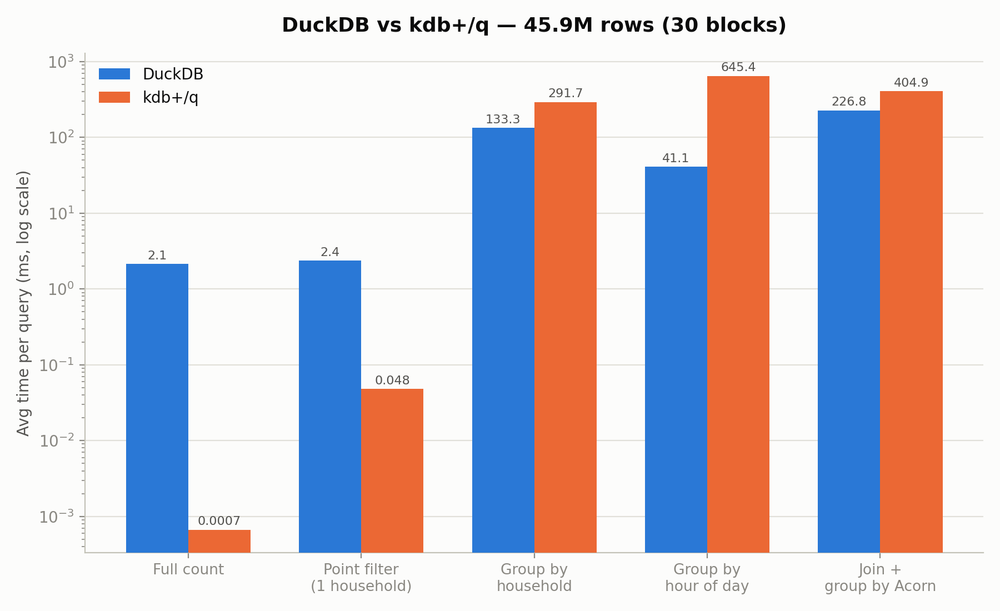
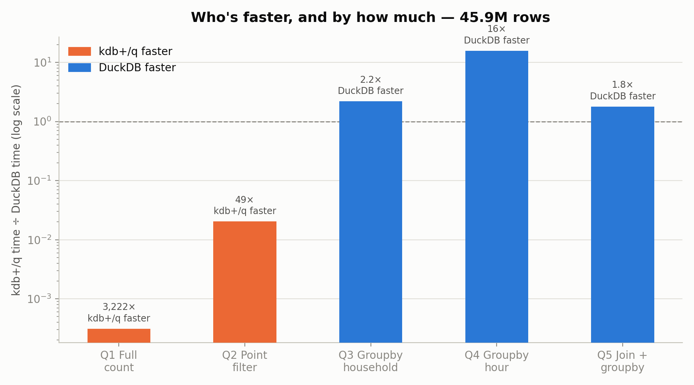
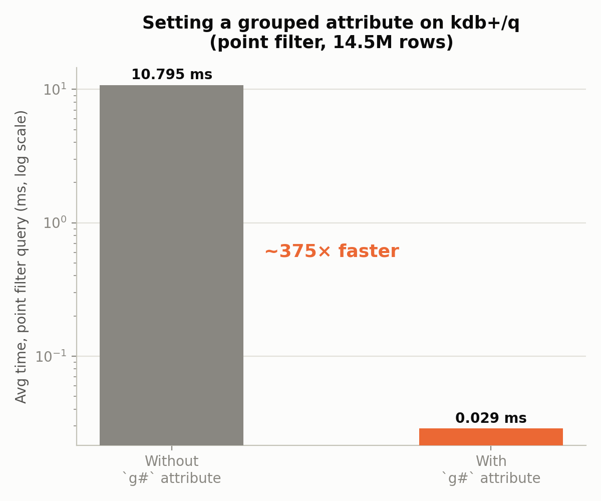
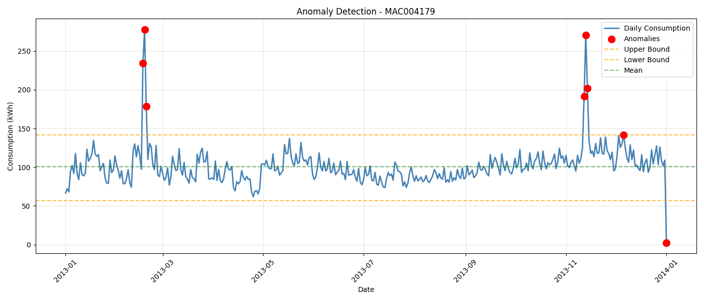

# ⚡ KDB+/Q vs SQL Benchmark

A same-machine performance comparison of kdb+/q and DuckDB on 46 million smart-meter readings, plus an AWS time-series analysis of the same dataset.

<a href="https://github.com/slastrzelec/energy-forecasting-sql-vs-kdb" target="_blank" rel="noopener noreferrer">GitHub Repository</a> · <a href="https://github.com/slastrzelec/energy-forecasting-sql-vs-kdb/tree/main/part2_kdb_vs_sql" target="_blank" rel="noopener noreferrer">Benchmark code and methodology</a>

## Why this project

I built it before an interview for a Junior KDB+/Q Developer role, to learn q by measuring something instead of reading about it. The question: on the same raw data and the same machine, where does kdb+/q beat a modern columnar SQL engine, and where does it not? Benchmarks that answer "kdb+ is faster" are easy to write. This one reports where it lost, and why.

The repository has two parts on the same "Smart meters in London" dataset. **Part 2**, the benchmark, is the main result and is described first. **Part 1** is an AWS (S3, Athena) analysis of the aggregated data with segmentation, anomaly detection and Prophet forecasts; it is shorter and has more caveats (see below).

## Results at a glance

Both engines ran the same 5 queries on the raw half-hourly readings (30 blocks, 45,948,372 rows), in the same WSL2 environment. kdb+ is KDB-X 5.0 Community Edition, DuckDB runs from Python. Times in milliseconds, average of 3 runs.

| Query | DuckDB | kdb+/q | Faster engine |
|---|---:|---:|---|
| Q1: full row count | 2.15 | 0.0007 | kdb+/q, ~3,220× |
| Q2: point filter (one household) | 2.36 | 0.048 | kdb+/q, ~49× |
| Q3: group by household | 133.33 | 291.66 | DuckDB, ~2.2× |
| Q4: group by hour of day | 41.12 | 645.38 | DuckDB, ~15.7× |
| Q5: join + group by Acorn group | 226.80 | 404.89 | DuckDB, ~1.8× |

## What the evaluation showed

- **A mixed result, not a win for either engine.** kdb+/q is far ahead on narrow operations (count, point lookup) and slower on grouping and joins, where DuckDB's optimiser does better. Q1 should be read with care: a row count in kdb+ is a stored length, so it says little about scan speed.
- **One attribute changes the point-filter result.** Setting the grouped attribute `` `g# `` on the filter column turned Q2 from a 10.79 ms linear scan into a 0.029 ms hash lookup (about 375×) for an indexing cost under a second. Without it, kdb+/q loses even Q2 to DuckDB.
- **A hypothesis that failed.** I expected the `` `tstp.hh `` temporal accessor to be the bottleneck of Q4 and tested an alternative extraction. The timings were the same (645.38 ms against 649.71 ms). The cost is in grouping by a derived column, not in the extraction.
- **A hardware limit, not a bug.** kdb+/q loaded all 112 blocks (167.8M rows, about 15 minutes) and was then killed by the WSL2 memory ceiling while holding 112 intermediate tables. The final benchmark uses 30 blocks, a size that runs repeatably, and the scope decision is documented.

## Methodology

- **Same work on both sides:** identical 5 queries on the same CSV files, the same machine and the same environment. The point-filter household is fixed in both scripts.
- **Load time is separate** from query time, because loading is a one-off cost and a real workload does not repeat it.
- **Data quality:** 50 rows per block hold the literal string `"Null"` instead of a number in the energy column. Both engines convert it to a proper null (`TRY_CAST` in DuckDB, string substitution in q) instead of failing or dropping rows.
- **Scale chosen from a measurement:** the largest size that completed repeatably, not an extrapolation from a smaller one.

## Part 1: AWS analysis of the aggregated data

Raw meter data in S3, queried with Athena (serverless SQL), then analysed in Python: 4,443 meters, 17,520 half-hourly observations, 2013; 305 meters with more than 20% missing data removed, 4,138 kept.

| What | Result |
|---|---|
| Consumption groups | Three groups of nearly equal size (34%, 33%, 33%) plus 2 inactive meters |
| Prophet forecasts, one meter per group | MAE 0.036, 0.070 and 0.495 from the lowest- to the highest-consuming group |
| Anomalies in the daily total | Z-score flagged 7 days, IQR 8 days; they agree on 87.5% |

Read these results with the caveats:

- **The group names are interpretation.** The groups were named Industrial, Commercial and Residential from consumption level. The dataset has no building-type label, so the names are not ground truth.
- **Three meters are a sample, not an evaluation.** The forecast errors come from one meter per group and show that error grows with consumption, not how well the method forecasts in general.
- **Explanations for the anomalous days are guesses.** A cold snap on 18 Feb 2013 (the highest day) is a plausible reason, but no weather data is used in the analysis, so it was not tested.

## Testing

There is **no automated test suite and no CI** in this repository. What was checked, by hand:

- Each timing is the average of repeated runs on the same machine; the DuckDB side was run against real data before the q side.
- The `"Null"` rows are handled in both engines.
- The one hypothesis test (Q4 accessor) is a controlled comparison.

**Not covered**

- **Equal results from both engines.** The q script does not record the number of rows a query returns, so the benchmark compares times, not that both engines return the same answer.
- **Other hardware, other data sizes and other versions.** The numbers come from one machine under WSL2 at 46M rows. kdb+/q ran out of memory at 167M rows, so that size was not compared.
- **Cold-cache runs and concurrent load:** not measured; each figure is an average of repeated runs.
- **Part 1:** no tests; the notebooks run against an S3 and Athena setup that is not in the repository.

## Limitations

- One machine, one data set and five queries are enough to show where each engine is strong, not to rank them in general.
- The benchmark ran on kdb+ Community Edition with no tuning beyond the grouped attribute.
- Part 1's conclusions are descriptive: the consumption groups, the anomaly explanations and the forecast errors come from small samples and no external labels.

**Tech stack:** kdb+/q (KDB-X 5.0 Community Edition), DuckDB, Python, WSL2, AWS S3 and Athena, pandas, statsmodels, Prophet, Plotly, matplotlib.

**Related:** a measurement-first project with a stricter test suite and written leakage rules is [ML Data Guard](../ml-data-guard/index.md).
