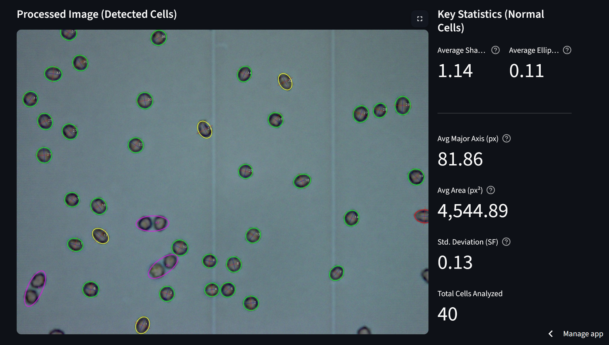
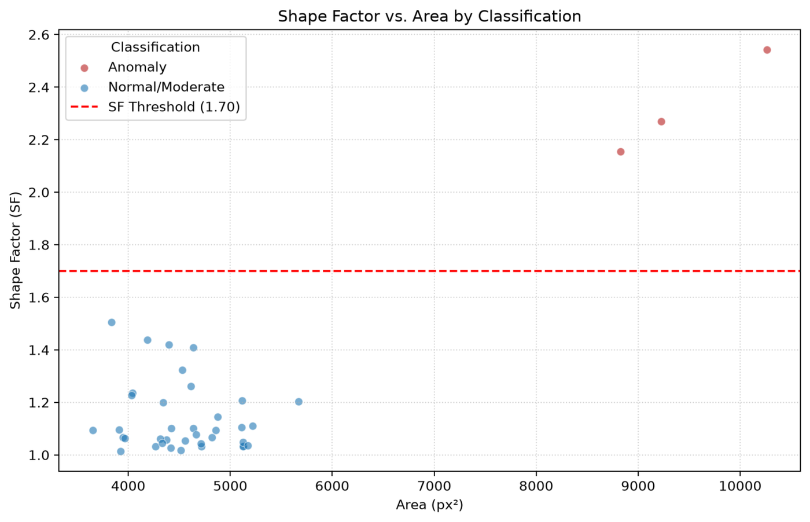
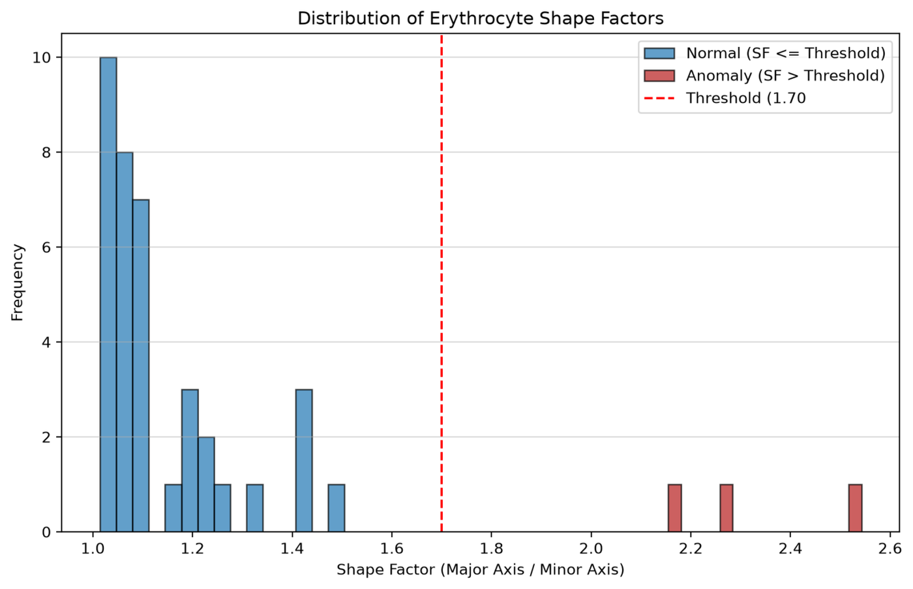

# 🔬 Erythrocyte Shape Analyzer

**Quantitative, image-based analysis of red blood cell morphology — classical computer vision (OpenCV) wrapped in an interactive Streamlit app.**

**Live demo:** <a href="https://erythrocyte-shape-analyzer.streamlit.app" target="_blank">erythrocyte-shape-analyzer.streamlit.app</a> · <a href="https://github.com/slastrzelec/erythrocyte-shape-analyzer" target="_blank">GitHub Repository</a>

*Green = normal, yellow = moderately elongated, red = highly elongated, magenta = anomaly — each cell is classified against a user-defined Shape Factor threshold.*

## Why this project

This was my first serious portfolio project, and it grew directly out of academic research: an investigation into the acute effects of functionalized carbon nanotubes (MWCNTs-Ni) on red blood cell function, where shape stability under toxic exposure is a key parameter. Rather than leaving the measurement pipeline as a one-off analysis script, I rebuilt it as a standalone, reusable tool — usable on any microscope image, not just the original research dataset.

It is the clearest before-and-after marker of how my engineering practice has changed. The repository history showed early-stage churn (duplicate repositories, unpinned dependencies) that I cleaned up instead of hiding; later I fixed a real drawing bug (the minor axis was not perpendicular to the major axis), pinned the dependencies, added a licence, rewrote the in-app science text for accuracy and added the tests below.

## What it does

The app automatically detects erythrocytes in a microscope image and measures their shape using contour detection and ellipse fitting. For every detected cell it computes:

* **Shape Factor** (major axis / minor axis) — a quantitative measure of elongation
* Ellipticity, area, and perimeter, with optional pixel → micrometer calibration
* An anomaly flag against a user-configurable Shape Factor threshold

Results are exportable as CSV or Excel, and the app also serves the original research publication as a downloadable PDF with a highlighted abstract.

## Methodology

1. Convert the image to grayscale and binarize it with **Otsu's method** (automatic threshold selection, robust to uneven illumination).
2. Detect external contours and filter out anything below a configurable minimum axis size (removes noise/debris).
3. Fit an ellipse to each remaining contour (`cv2.fitEllipse`) and compute Shape Factor = major axis / minor axis.
4. Classify each cell as normal or anomalous against the threshold, and compute area/perimeter/ellipticity alongside it.

*Shape Factor vs. Area — anomalies (red) separate cleanly from the normal population.*

*Shape Factor distribution across the analyzed sample.*

## Testing

**Automated tests run on every push and pull request** (pytest in GitHub Actions) against the core detection and measurement logic, `shape_analysis.py`.

A real microscope image has no known ground truth, so the tests use **synthetic images with hand-drawn ellipses of known size**. The expected Shape Factor, ellipticity and area are computed independently and compared with what the pipeline returns.

**What is verified**

- Shape Factor correctness on ellipses of known dimensions.
- Normal and anomaly classification against the threshold.
- Filtering of artefacts by size, and detection of several cells in one image.
- Consistency between the colour band shown and the classification (a bug that was fixed).

**Not covered**

- **Detection accuracy on real images.** There is no comparison of the detected cells with a manual count or manual outlines.
- Overlapping or touching cells, uneven staining and other microscope conditions beyond the synthetic images.
- The Streamlit interface and the export to CSV and Excel.

## Limitations

- **Shape Factor is an elongation index.** A perfectly spherical cell and a normal, healthy biconcave cell both give a Shape Factor close to 1, so this metric does not separate spherocytosis-type anomalies. It is built to detect elongation (elliptocytosis-type) shape change, not roundness.
- A single user-set threshold decides what is anomalous.
- This is a research and demonstration tool, **not a medical diagnostic device**.

## Research context

The methodology is based on a study investigating multi-walled carbon nanotubes with attached Ni²⁺ ions (MWCNTs-Ni) and their acute effects on red blood cell function. The low concentration tested didn't change red blood cell size or shape, but it did affect haemoglobin's states and its ability to reversibly bind oxygen — MWCNTs-Ni-treated cells showed an increased affinity for O₂, similar to red blood cells from essential hypertensive subjects, pointing to a potential risk that MWCNTs-Ni exposure could influence hypertension development. The full publication is downloadable from within the app.

**Tech stack:** Python, Streamlit, OpenCV, NumPy, pandas, Matplotlib, openpyxl, pytest, GitHub Actions.

**Related:** for a contrasting computer-vision approach on the same broad problem (detecting and characterizing objects in images) — a modern deep-learning object detector plus multi-object tracking, instead of classical contour/ellipse fitting — see the [People Counter](../people-counter-yolox/index.md) project. For a learned (rather than hand-engineered) approach to analyzing image content, see [Emotion Recognition](../emotion-recognition-cv/index.md), a fine-tuned ResNet18 classifying facial expressions.
