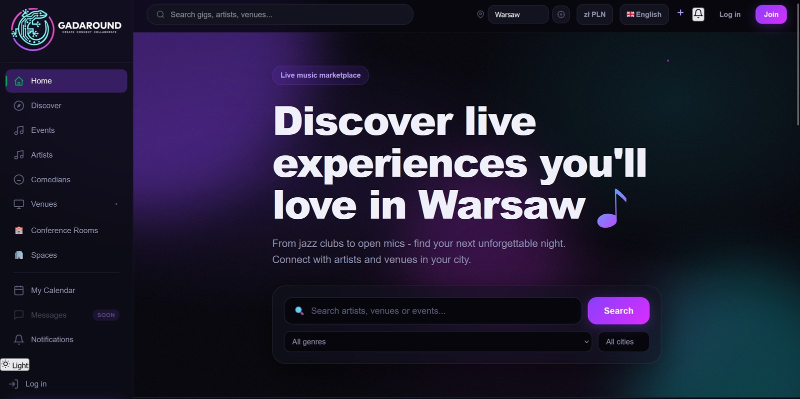

# ☁️ GadAround on Google Cloud

Migration of a startup's event-marketplace app from a local SQLite setup to Google Cloud (Cloud Run and Cloud SQL), with a CI/CD pipeline that needs no stored keys and a custom domain served through a Cloudflare reverse proxy.

<a href="https://www.gadaround.pl/" target="_blank" rel="noopener noreferrer">Live site (gadaround.pl)</a> · Repository: private (startup code)



## Why this project

GadAround is an early-stage marketplace that connects artists, venues and event-goers: event discovery by genre, artist and venue directories, event creation, a calendar and a multilingual interface. I joined the two-person team as the AI/ML developer, and the first thing the product needed was a reliable place to run. The app existed as a Flask monolith on SQLite, so I took over the move to a managed cloud setup and the delivery pipeline around it. This page covers that infrastructure work; it does not describe the application's features or its AI components.

## What was delivered

| Area | Result |
|---|---|
| Hosting | Flask app on Cloud Run (region europe-central2), multi-container deployment defined in a service YAML |
| Database | SQLite replaced by PostgreSQL on Cloud SQL (small shared tier), reached through a Cloud SQL Auth Proxy sidecar |
| Secrets | Database URL and app key in Secret Manager, nothing in the repository |
| Cost control | Monthly budget limit of 200 PLN |
| CI/CD | Merge `dev` → `main` builds a Docker image, pushes it to Artifact Registry and deploys to Cloud Run |
| Authentication to GCP | Workload Identity Federation from GitHub Actions, no JSON keys |
| Domain | `gadaround.pl` and `www` served through Cloudflare, ownership verified in Google Search Console |

## Architecture

```
GitHub (dev → main) → GitHub Actions → Docker image → Artifact Registry
                                                    → Cloud Run service
Browser → Cloudflare (DNS + Worker reverse proxy) → Cloud Run [app + Cloud SQL Auth Proxy] → Cloud SQL (PostgreSQL)
```

- **Deployment unit:** two containers in one Cloud Run revision: the app and the Cloud SQL Auth Proxy, so the app reaches the database through the proxy.
- **Pipeline:** a merge into `main` builds and pushes the image and applies the service definition with `gcloud run services replace`. The run is checked by an HTTP 200 response after deployment.
- **Keyless authentication:** the GitHub provider is restricted to one repository and the `main` branch, and the service account has only the roles the pipeline needs (Cloud Run admin, Artifact Registry writer, service account user).
- **Custom domain:** Cloud Run domain mappings are not available in europe-central2, and Firebase Hosting was ruled out because it strips cookies (the app relies on session, CSRF and language cookies). I chose Cloudflare's free plan with a Worker as a reverse proxy that forwards the original host header and rewrites redirect `Location` headers.

## Security

- Rotated the application database user's password and the app secrets, and disabled the old secret versions.
- Reviewed IAM roles and access; the second developer works through GitHub on a `dev` branch with limited permissions.
- The repository is private and stays under my control until the collaboration terms are settled.

## Testing

**What is verified**

- The pipeline has run end to end: merge to `main`, image build, push and deployment, ending with an HTTP 200 from the service.
- The domain is active and the site loads at `gadaround.pl` and `www.gadaround.pl`.

**Not covered**

- Login and cookie behaviour through the Cloudflare proxy on `gadaround.pl` is not yet tested end to end.
- Rollback (shifting traffic back to a previous Cloud Run revision) is documented but not rehearsed.
- No load or failover testing, and this page does not cover the application's own test suite.

## Limitations

- A runbook (branches, auto-deploy, rollback, local work with docker-compose) is written but not yet merged into `main`, and it has no section on Cloudflare yet.
- The setup targets an early-stage product: a small shared Cloud SQL tier, one region and no high availability.
- The project is a startup's private code base, so the repository cannot be shown; I can walk through the architecture and the pipeline on request.

**Tech stack:** Google Cloud Run, Cloud SQL (PostgreSQL), Secret Manager, Artifact Registry, Workload Identity Federation, Docker, GitHub Actions, Cloudflare (DNS, Workers), Python, Flask.

**Related:** the [Carbon Nanotubes RAG System](../carbon-nanotubes-rag/index.md) and the [Scientific Research Agent](../research-agent-langchain/index.md) both run automated tests on every push through GitHub Actions, and the Research Agent documents its threat model in a spec.
