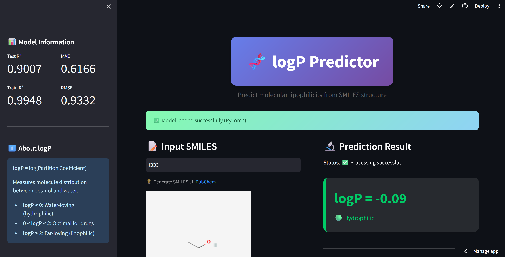
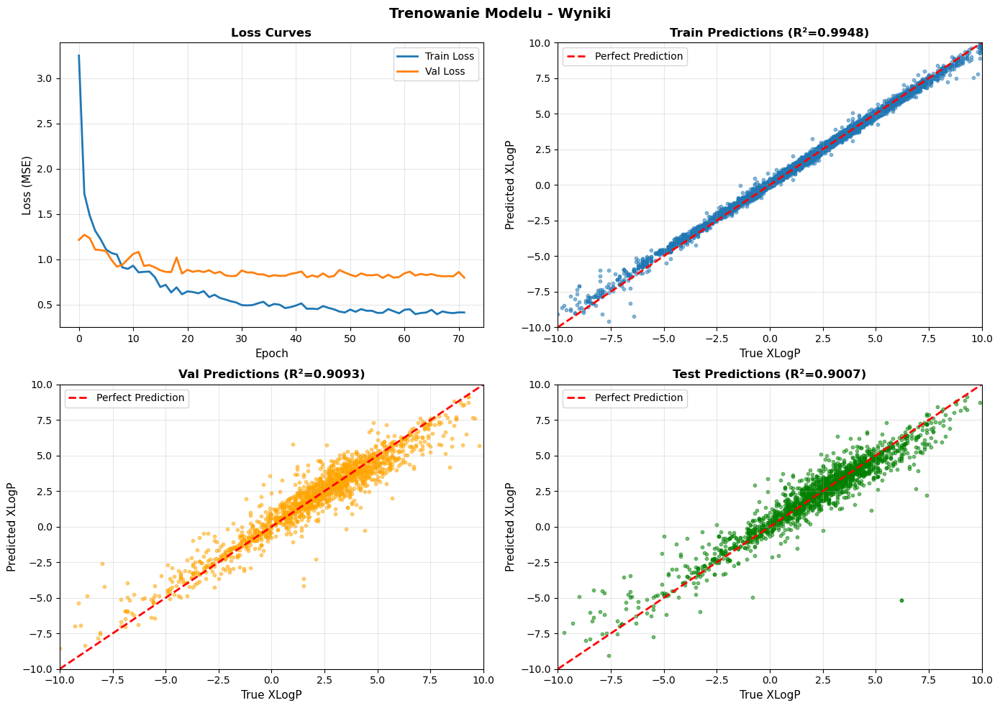

# 🧬 Molecular logP Predictor

A PyTorch neural network that predicts logP (the octanol/water partition coefficient) from a SMILES string, with a Streamlit app and a unit-tested feature pipeline.

<a href="https://github.com/slastrzelec/molecular-lipophilicity-ai" target="_blank" rel="noopener noreferrer">GitHub Repository</a> · <a href="https://molecular-lipophilicity-ai.streamlit.app/" target="_blank" rel="noopener noreferrer">Live demo (Streamlit)</a>

## Why this project

logP is one of the first numbers a chemist looks at for a new molecule: it drives membrane permeability, solubility and oral bioavailability. Computing it for thousands of candidate structures needs a model that takes a SMILES string and answers in milliseconds. This project trains one on 11,612 molecules from PubChem and wraps it in an app that checks the structure, shows it and explains the number.

## Results at a glance

A 4-layer MLP (2054 → 512 → 256 → 128 → 1, 1,218,305 parameters; BatchNorm, ReLU and Dropout 0.3 in every layer) on 2048-bit Morgan fingerprints plus 6 physicochemical descriptors (molecular weight, TPSA, hydrogen-bond donors and acceptors, rotatable bonds and others).

| Split | R² | MAE |
|---|---|---|
| Train | 0.9948 | 0.141 |
| Validation | 0.9093 | 0.605 |
| Test | 0.9007 | 0.617 |

The parity plots show predictions close to the identity line across the range of the data (about -10 to +10 logP). Training stopped early at epoch 72 of 100.

## What the evaluation showed

- **The train/test gap is real and was not hidden.** R² 0.99 against 0.90 is the usual picture for a model with about 1.2 million parameters trained on about 11.6 thousand molecules. It was kept in check with dropout, batch normalisation and early stopping instead of by adding capacity.
- **Test error is about 0.6 log units.** That is useful for ranking and filtering candidates; it is not the accuracy of a measurement.

## Methodology

- **Features:** a hybrid vector of Morgan fingerprints (substructure presence) and six scaled descriptors (global properties). The scaler parameters are stored with the data and loaded at prediction time, so the app applies exactly the scaling used in training.
- **Training:** MSE loss, validation-based early stopping, the best epoch is saved as the checkpoint.
- **Data:** PubChem logP values; preprocessing is outlier removal and standard scaling. The raw 92 MB file is not in the repository (the README explains how to obtain it); the processed data used for training is.
- **App:** RDKit validates the structure first, draws it for a visual check, and the prediction is shown with a colour-coded interpretation (from very hydrophilic to highly lipophilic).

## Testing

**14 automated tests run on every push and pull request** (pytest in GitHub Actions). They need no GPU and no network; the end-to-end tests load the real trained checkpoint.

**What is verified**

- **Feature pipeline:** a valid SMILES gives a vector of the right size (2048 + 6); an invalid or empty SMILES string returns an error instead of a prediction.
- **Two bugs that were found and fixed, now covered by regression tests:** a bare `except` used to turn failing descriptor calculations into six silent zeros, and an empty string was parsed by RDKit as a valid empty molecule and produced a nonsense prediction. A test requires real descriptors for a valid molecule, and another requires that a failing scaling step is reported as an error.
- **Prediction:** the output is a finite number in a sane range, and different molecules give different predictions (this guards against predicting on a constant input).
- **Interpretation:** every logP category and the bucket boundaries.

**Not covered**

- The model's accuracy: tests check that the pipeline works, not that R² stays at 0.90. There is no test that retrains the model.
- Chemical plausibility of single predictions: there is no comparison with reference logP values for known molecules.
- The Streamlit interface and the deployed demo: there are no automated tests for them.

## Limitations

- The numbers above come from one held-out test split of a single PubChem dataset. No scaffold-based split and no external dataset are reported, so how the model behaves on a new chemical series is not measured.
- The labels are the PubChem logP values (experimental and computed), so the model inherits whatever noise they carry.
- A point prediction only: no uncertainty estimate and no applicability-domain check (the Drug Solubility Predictor has both).

**Tech stack:** Python, PyTorch, RDKit, scikit-learn, pandas, NumPy, Streamlit, pytest, GitHub Actions.

**Related:** the [Drug Solubility Predictor](../drug-solubility-prediction/index.md) solves a neighbouring task (a single-molecule property from RDKit features, with Random Forest and uncertainty estimates). The [Buchwald-Hartwig C-N Coupling Optimizer](../buchwald-hartwig-optimizer/index.md) uses the same cheminformatics toolkit for reaction yield instead of a molecule property.
