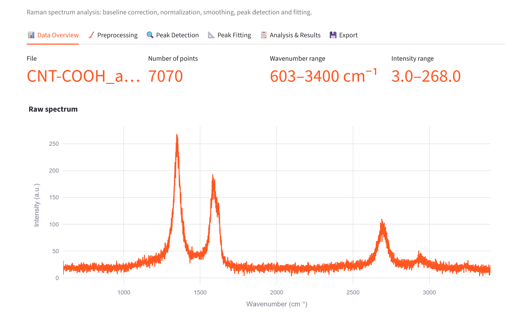
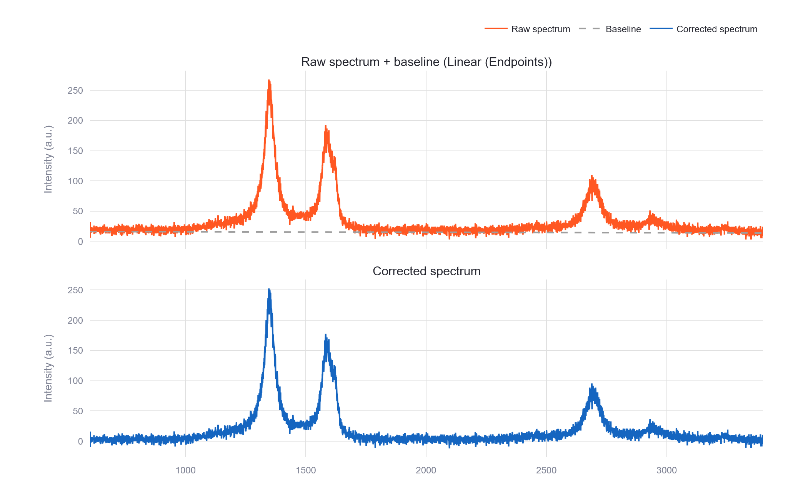
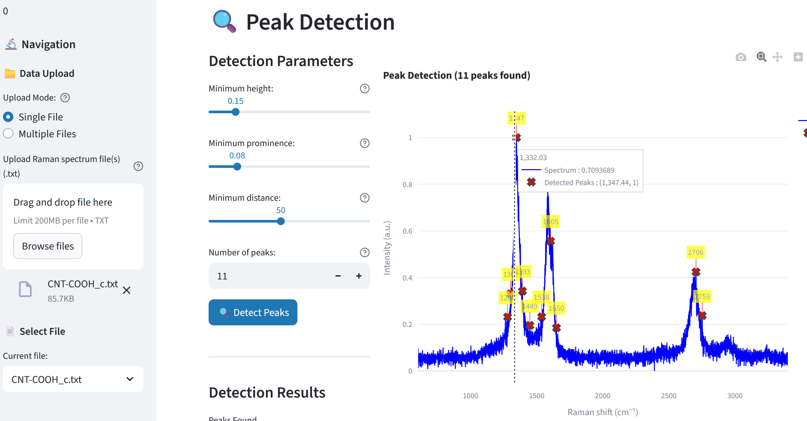

# 🌈 Raman Spectroscopy Analyzer

A Streamlit app that takes a raw Raman spectrum through baseline correction, normalisation, smoothing, peak detection and peak fitting, and exports the results, with a focus on carbon materials such as carbon nanotubes and graphene.

<a href="https://github.com/slastrzelec/raman-spectroscopy-analyzer" target="_blank" rel="noopener noreferrer">GitHub Repository</a> · <a href="https://raman-spectroscopy-analyzer.streamlit.app/" target="_blank" rel="noopener noreferrer">Live demo (Streamlit)</a>

## Why this project

Analysing a Raman spectrum of a carbon material means a baseline, a normalisation, a peak table and then the ratio of the D and G bands as a measure of defects. Each step involves a choice that changes the final number. This tool puts the whole chain in one app, shows the result of every step on a plot, and applies the same settings to many files at once.

## Results at a glance

The tool does not produce a model score. What it gives is a processed spectrum and a table:

| Step | Options |
|---|---|
| Baseline | Linear (endpoints), Asymmetric Least Squares |
| Normalisation | Min-Max, maximum intensity, area, vector (L2) |
| Smoothing | Savitzky-Golay (optional) |
| Peak fitting | Lorentzian, Gaussian, Pseudo-Voigt (bounded least squares with parameter uncertainties from the covariance matrix) |
| Quantities | ID/IG, I2D/IG, crystallite size La from the Tuinstra-Koenig relation |
| Export | CSV (spectrum, peaks, fit), XLSX, a TXT report, and a ZIP for batch runs |

Example: a sample CNT-COOH spectrum of 7,070 points between 603 and 3,400 cm⁻¹; on another sample spectrum, automatic peak detection (minimum height 0.15, prominence 0.08) finds 11 peaks.

## What the tool shows

- **Background removal exposes the carbon bands.** On the sample spectrum the D, G and 2D bands are clearly resolved once the fluorescence background is subtracted; the app plots the raw spectrum with the fitted baseline and the corrected spectrum below it.
- **The excitation wavelength enters the crystallite size.** The Tuinstra-Koenig relation depends on the laser wavelength (458–785 nm), so it is a parameter of the app and not a hardcoded constant.

## Methodology

- **Specification first.** `SPEC.md` describes the architecture, the reason for each dependency version and the data-security rules. A first version was deleted and rebuilt from scratch under this specification after repeated deployment crashes.
- **Logic apart from the interface.** The Streamlit file only orchestrates; loading and validation, preprocessing, peak detection and fitting, visualisation, export and batch processing are separate modules that tests can call without a browser.
- **Input validation:** one file or several `.txt` files with two columns (wavenumber, intensity), checked on load.

## Testing

**65 automated tests run on every push** (pytest in GitHub Actions).

**What is verified**

- **Each module of the logic layer:** data loading and validation, preprocessing, peak detection, peak fitting, export and batch processing.

**Not covered**

- **Agreement with reference values.** No comparison with other Raman software or with published ratios for the sample spectra is documented, so the tests show that the code runs as designed, not that the numbers match another tool.
- The Streamlit interface and the interactive charts.
- Spectra of materials other than the carbon samples used during development.

## Limitations

- The Tuinstra-Koenig relation was derived for graphitic carbons. For nanotube samples the crystallite size from ID/IG is an indication, not a measurement.
- I2D/IG as a layer count applies to graphene; for nanotubes it should be read with the same care.
- The sample data are three CNT-COOH spectra; the behaviour on noisy or strongly fluorescent spectra of other materials was not evaluated.

**Tech stack:** Python, Streamlit, NumPy, pandas, SciPy, Plotly, Matplotlib, pytest, GitHub Actions.

**Related:** the same carbon-nanotube topic is covered by the [Carbon Nanotube Visualizer](../carbon-nanotube-visualizer/index.md) (structure and electronic properties) and the [Carbon Nanotubes RAG System](../carbon-nanotubes-rag/index.md) (questions over the research literature).
