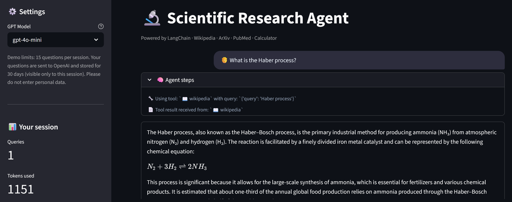

# 🤖 Scientific Research Agent

A tool-using LLM agent (LangChain and LangGraph) that answers scientific questions by choosing between Wikipedia, ArXiv, PubMed and a safe calculator, hardened for a public demo and tested without an API key.

<a href="https://github.com/slastrzelec/research-agent-langchain" target="_blank" rel="noopener noreferrer">GitHub Repository</a> · <a href="https://github.com/slastrzelec/research-agent-langchain/blob/main/SPEC.md" target="_blank" rel="noopener noreferrer">Spec and threat model</a> · <a href="https://research-agent-langchain.streamlit.app/" target="_blank" rel="noopener noreferrer">Live demo (Streamlit)</a> · <a href="https://github.com/slastrzelec/research-agent-langchain/tree/main/evaluation" target="_blank" rel="noopener noreferrer">Evaluation code and raw results</a>



## Why this project

An agent that can call tools is easy to demo and easy to get wrong in public: the model may pick the wrong tool, a calculator tool may execute arbitrary code, a visitor may run up the token bill, and one visitor may see another's history. This project builds a small research agent with these problems handled and measured: safe calculation, usage limits, per-session data, source links under each answer, and an evaluation harness with a held-out split. Answer quality is only partly measured (tool choice, calculator, safety, sources on a small dev set); the factual quality of free text is not.

## Results at a glance

Dev set: 16 of the 32 hand-written cases, gpt-4o-mini, one real run.

| Measure | Result |
|---|---|
| Tool choice | 14/14 (95% CI 0.79–1.00) |
| Calculator correctness | 3/3 |
| Safety behaviour | 2/2 |
| Sources shown | 10/10 |
| Cost | about 1,000 tokens and 5.5 s per question |

The `test` split has not been run yet, and with 16 cases the intervals are wide. Treat these numbers as a smoke check, not a benchmark.

## What the evaluation showed

- **The harness separates tuning from judging.** Cases are split into `dev` (for tuning) and `test` (run once per configuration, which the runner enforces), and a test checks that no evaluation question leaks into the prompt or code. Results are published only after a real run.
- **What a visitor gets next to the answer:** links to the pages and papers the tools actually retrieved, and the agent's reasoning steps.

## Methodology

```
User question → LLM chooses a tool → tool runs (Wikipedia / ArXiv / PubMed / Calculator)
             → LLM observes the result → final answer + source links
```

- **Pattern:** ReAct loop on LangGraph with gpt-4o-mini (gpt-4o selectable), the last 6 messages as short-term memory, and optional LangFuse tracing when keys are configured.
- **Tools:** Wikipedia and ArXiv through own clients, PubMed through NCBI E-utilities, and a calculator that parses the expression as an AST and never calls `eval`.
- **Cost and safety limits:** question length, per-session and daily token budgets, a recursion limit and escaped HTML.
- **Data:** queries are logged to SQLite with tokens and tools used, visible only to the session that made them and kept for 30 days; CSV export is protected against formula injection.
- **Specification first:** `SPEC.md` holds the threat model that the tests below follow.

## Testing

**95 automated tests run on every push** (GitHub Actions, with lint and a dependency audit). The suite needs no API key and no network, so it runs in seconds.

**What is verified**

- **Security:** the calculator rejects code injection and resource-exhaustion input (a test proves a malicious expression never touches the file system); HTML in questions and answers is escaped; Markdown images are stripped from model output; CSV export is protected against formula injection.
- **Agent logic:** the real LangGraph agent is driven by a scripted fake model: tool calls, token counting, source collection, the recursion limit and history truncation.
- **Resilience:** the Wikipedia, ArXiv and PubMed clients are tested against timeouts, HTTP errors, malformed JSON or XML and XML-bomb input; none of them crashes the agent.
- **Cost control and privacy:** per-session and daily budgets, per-session data isolation, SQL-injection strings stay inert, schema migration and 30-day retention.
- **UI:** Streamlit `AppTest` checks rendering, the limits and that one visitor never sees another's history.

**Not covered**

- Real calls to OpenAI and the search APIs are verified by hand on the live demo, not in CI.
- The factual quality of free-text answers is not measured automatically.

## Limitations

- The evaluation is small (32 cases, 16 on the dev split run so far), so the confidence intervals are wide and the `test` split is still unused.
- Free-text answers can contain errors that no metric here catches; the sources are there so that a reader can check them.
- Conversation memory is short (6 messages) and the data store is SQLite, which suits a demo and not a multi-user service.

**Tech stack:** Python 3.11, LangChain, LangGraph, OpenAI API, LangFuse, Streamlit, SQLite, Plotly, pandas, pytest, ruff, GitHub Actions.

**Related:** the [Carbon Nanotubes RAG System](../carbon-nanotubes-rag/index.md) adds retrieval with a measured answer quality (RAGAs), and the [CV Job Matcher](../cv-job-matcher/index.md) uses OpenAI embeddings for semantic ranking.
